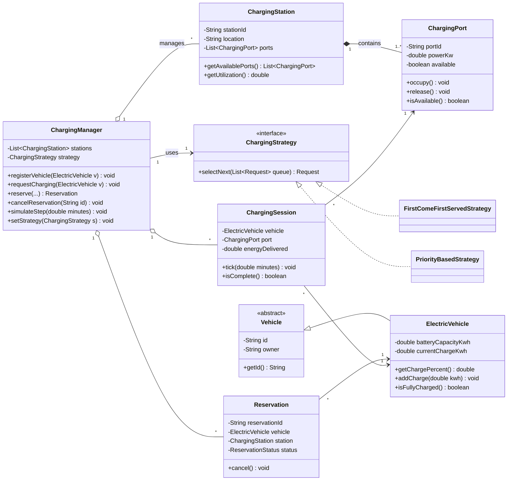

<div align="center">

### ⚡ Simulating the future of electric mobility, one charging session at a time ⚡
 


 
</div>
---
 
## 📑 Table of Contents
 
- [Overview](#-overview)
- [Features](#-features)
- [Architecture](#-architecture)
- [UML Class Diagram](#-uml-class-diagram)
- [Allocation Strategies](#-allocation-strategies)
- [Getting Started](#-getting-started)
- [Demo Scenarios](#-demo-scenarios)
- [Testing](#-testing)
- [Adding a New Strategy](#-adding-a-new-strategy)
- [Project Structure](#-project-structure)
- [Team](#-team)
---
 
## 🌍 Overview
 
**Smart Electric Vehicle Charging Management System** is a Java application that simulates electric-vehicle charging infrastructure. It models vehicles, stations, ports, reservations and charging sessions, and lets the operator choose **how scarce charging resources are allocated** when demand exceeds supply.
 
> **Example:** two vehicles request charging while only one port is free. The selected strategy decides who gets the port, the other vehicle is placed in the waiting queue, and both sessions are updated as the simulation advances.
 
**Topic:** Green technology · Electric mobility · Resource allocation
 
---
 
## ✨ Features
 
| | Feature | Description |
|---|---|---|
| 🚗 | **Vehicle registration** | Register EVs with battery capacity and current charge level |
| 🔌 | **Station & port management** | Stations contain ports; track availability in real time |
| 📅 | **Reservations** | Create, cancel and inspect charging reservations |
| 🔋 | **Charging simulation** | Step-based sessions that update vehicle charge levels |
| 🧠 | **Pluggable allocation policies** | First-come-first-served and priority-based, easily extended |
| 📊 | **Reporting** | Station utilization and completed charging sessions |
 
---
 
## 🏗 Architecture
 
The design follows a few deliberate principles:
 
- **Composition** – a `ChargingStation` *has* `ChargingPort`s; sessions link vehicles and reservations.
- **Inheritance only where it makes sense** – `ElectricVehicle` extends `Vehicle` to specialize shared behavior.
- **Strategy pattern** – allocation logic lives behind the `ChargingStrategy` interface.
- **Separation of concerns** – resource allocation is kept apart from station management and charging calculations.
---
 
## 🧩 UML Class Diagram
 

 
> 📝 *Adjust method and field names to match your actual code.*
 
---
 
## 🧠 Allocation Strategies
 
| Strategy | How it decides | Best for | Trade-off |
|---|---|---|---|
| **FirstComeFirstServed** | Earliest request gets the next free port | Fairness, simplicity | Urgent vehicles may wait behind low-need ones |
| **PriorityBased** | Highest priority (e.g. low battery, premium, emergency) goes first | Critical or time-sensitive charging | Lower-priority vehicles can wait longer |
 
---
 
## 🚀 Getting Started
 
### Prerequisites
 
- Java 17 or newer
- Maven or Gradle *(update to match your build tool)*
### Build & Run
 
```bash
# Clone the repository
git clone https://github.com/<your-username>/<your-repo>.git
cd <your-repo>
 
# Build
mvn clean package
 
# Run the demo
java -jar target/ev-charging.jar
```
 
---
 
## 🎬 Demo Scenarios
 
<details>
<summary><b>Scenario 1 · Port contention</b></summary>
Two vehicles request charging with only one port available. The active strategy assigns the port, the second vehicle is queued, and sessions update as the simulation runs.
 
</details>
<details>
<summary><b>Scenario 2 · Reservation cancellation</b></summary>
A reservation is created, then cancelled. The port is released and becomes available to the next vehicle in the queue.
 
</details>
<details>
<summary><b>Scenario 3 · Strategy comparison</b></summary>
The same set of requests is run under FCFS and Priority-Based allocation to compare ordering, waiting time and station utilization.
 
</details>
---
 
## 🧪 Testing
 
Tests cover:
 
- ✅ Port and station **availability**
- ✅ **Allocation policies** (FCFS and priority-based)
- ✅ **Battery-level updates** during charging
```bash
mvn test
```
 
---
 
## 🔧 Adding a New Strategy
 
1. Create a class implementing `ChargingStrategy`:
```java
public class ShortestChargeFirstStrategy implements ChargingStrategy {
    @Override
    public Request selectNext(List<Request> queue) {
        // return the request that needs the least energy
    }
}
```
 
2. Register it with the manager:
```java
manager.setStrategy(new ShortestChargeFirstStrategy());
```
 
No changes to stations, ports or sessions are needed, because allocation is isolated behind the interface.
 
---
 
## 📂 Project Structure
 
```text
.
├── src
│   ├── main/java
│   │   ├── model        # Vehicle, ElectricVehicle, ChargingStation, ChargingPort,
│   │   │                # Reservation, ChargingSession
│   │   ├── strategy     # ChargingStrategy, FirstComeFirstServedStrategy,
│   │   │                # PriorityBasedStrategy
│   │   ├── service      # ChargingManager
│   │   └── Main.java    # Demo scenarios
│   └── test/java        # Unit tests
├── docs                 # UML diagram and report
└── README.md
```
 
---
 
## 👥 Team
 
| Name | Role | GitHub |
|---|---|---|
| Ghada Ben Amira | Coordinator | [@username](https://github.com/ghadabenamira) |
| *Teammate* | *e.g. Strategies* | [@username](https://github.com/username) |
| *Teammate* | *e.g. Testing & report* | [@username](https://github.com/username) |
 
---
 
<div align="center">
**Built with ☕ and 🔋 for a greener future**
 

</div>
 
